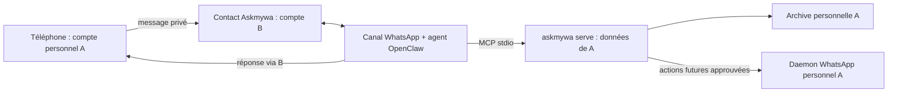

# Un contact Askmywa dans WhatsApp et un accès depuis le téléphone

Étude du 17 novembre 2026, sur `main` à
`3ebc1333561ace094eccac242f8dcfbc2590e212`. Proposition à valider par un
prototype ; aucune connexion personnelle ni publication de serveur réalisée.

## Le parcours visé

L'utilisateur écrit à un contact **Askmywa** dans WhatsApp : « Qu'est-ce que
j'avais convenu avec Élodie ? ». L'agent consulte **le MCP déjà relié au compte
personnel de cet utilisateur**, puis répond dans cette conversation. Le même
accès aux données doit être utilisable depuis Claude ou ChatGPT sur téléphone.

Le MCP reste la source des outils et de l'archive. Le contact WhatsApp et les
applications d'IA sont des points d'entrée vers cette même capacité.

## Ce que le dépôt permet déjà

| Élément | Code actuel | Conséquence |
| --- | --- | --- |
| Session WhatsApp personnelle et archive locale | [`internal/daemon`](../whatsapp-go/internal/daemon/), [`internal/store`](../whatsapp-go/internal/store/) | Réutiliser cette session et cette archive. |
| Quinze outils MCP, dont recherche, contexte et envoi | [`mcpserver.New`](../whatsapp-go/internal/mcpserver/server.go) | Un nouvel agent peut appeler les outils existants. |
| Transport MCP en entrée/sortie du programme | [`runServe`](../whatsapp-go/main.go) | Un agent sur la même machine peut lancer `askmywa serve`. Aucun endpoint HTTP n'est livré. |
| Envoi par le client WhatsApp du daemon | [`send.go`](../whatsapp-go/internal/daemon/send.go) | Les envois partent toujours du compte lié à ce daemon. Le renommer ne crée pas une identité d'assistant. |
| Dossier de données configurable | [`config.go`](../whatsapp-go/internal/config/config.go) | Des sessions distinctes peuvent utiliser des dossiers distincts. Le gestionnaire de service conserve cependant un nom global fixe. |

Le traitement des messages entrants les archive ; il ne lance aucun modèle.
Le socket IPC expose des requêtes ponctuelles, sans abonnement aux événements.
Le dépôt ne contient donc pas encore de boucle « message reçu → agent → MCP →
réponse ».

## Le chemin le plus court : réutiliser OpenClaw pour le contact

OpenClaw dispose déjà d'un canal WhatsApp basé sur WhatsApp Web/Baileys. Sa
documentation recommande un numéro distinct pour l'assistant et prévoit une
liste d'expéditeurs autorisés. Ce canal est une intégration WhatsApp Web,
distincte de la Business Platform officielle.
([Documentation du canal](https://docs.openclaw.ai/channels/whatsapp))

OpenClaw sait également consommer un serveur MCP local en stdio, avec filtrage
des outils. **Il n'est donc pas nécessaire de réimplémenter un agent IA dans
Askmywa pour essayer ce parcours.** C'est notre conclusion d'architecture à
partir des deux interfaces documentées, pas une intégration testée de bout en
bout. ([Client MCP OpenClaw](https://docs.openclaw.ai/tools/mcp))

Les deux identités ont des rôles précis :

- **A**, le compte personnel déjà connecté à Askmywa : recherche dans les
  conversations et, plus tard, envoi au nom de l'utilisateur.
- **B**, un compte avec un numéro dédié : reçoit les demandes adressées à
  Askmywa et répond à l'utilisateur. Ses identifiants restent dans le canal
  OpenClaw, séparés des identifiants de A.

Le numéro B doit correspondre à un véritable compte WhatsApp. Un numéro virtuel
peut être une option s'il permet effectivement l'inscription ; un numéro
inventé dans le code ne suffit pas. La configuration du canal ne doit pas
réutiliser les fichiers de session de A.

### Essai personnel à réaliser

L'agent doit aussi disposer d'un fournisseur de modèle configuré. Le MCP
fournit les outils et les données ; il ne génère pas les réponses à lui seul.

1. Conserver le daemon et le dossier Askmywa de A.
2. Lier B au canal WhatsApp OpenClaw, avec accès privé limité au propriétaire,
   groupes désactivés et auto-conversation désactivée. Choisir un runtime
   OpenClaw compatible avec le MCP stdio ; tous ses adaptateurs n'acceptent pas
   les mêmes transports.
3. Enregistrer le serveur MCP avec le chemin absolu du binaire et les arguments
   `serve --data-dir /chemin/absolu/vers/les-donnees-de-A`.
4. Limiter les outils MCP aux neuf outils de lecture : `whatsapp_status`,
   `search_contacts`, `list_chats`, `list_messages`, `get_chat`,
   `get_direct_chat_by_contact`, `get_contact_chats`, `get_last_interaction`,
   `get_message_context`. Restreindre aussi les autres outils du runtime :
   filtrer ce MCP seul ne retire pas les capacités shell ou fichiers de l'agent.
5. Vérifier la découverte avec `openclaw mcp doctor askmywa --probe`, puis
   poser depuis A une question dont la réponse existe seulement dans l'archive
   de A. La réponse doit arriver depuis B. Préparer d'abord les échanges sur
   des comptes et données de test.

Les opérations CLI qui modifient/probent le registre MCP OpenClaw demandent
actuellement l'arrêt de son Gateway ; son interface de réglages permet les
opérations à chaud qu'elle prend en charge.
([Référence du registre](https://docs.openclaw.ai/cli/mcp/registry))

Critères de réussite : recherche dans la bonne archive ; réponse depuis B ;
refus d'un autre expéditeur ; absence de réponse dans les groupes ; pas de
boucle sur les réponses du bot ni de commande rejouée à la reconnexion ; arrêt
et reprise propres ; aucun envoi depuis A dans ce premier essai.

OpenClaw prévoit aussi un mode « message à soi-même ». Il peut servir à essayer
la boucle sans deuxième numéro, mais n'affiche pas un contact Askmywa séparé.

NanoClaw constitue une autre piste : son agent accepte des serveurs MCP externes
et ses transports stdio/HTTP. Il s'exécute en conteneur : un binaire macOS, les
chemins de l'hôte et le socket Unix Askmywa ne deviennent pas accessibles dans
ce conteneur par simple configuration. L'intégration demanderait un pont ou un
transport adapté. Pour ce premier essai sur le Mac existant, OpenClaw évite ce
travail supplémentaire.
([Runner NanoClaw](https://github.com/nanocoai/nanoclaw/blob/main/docs/agent-runner-details.md),
[configuration MCP](https://github.com/nanocoai/nanoclaw/blob/main/docs/templates.md))

## Claude et ChatGPT sur téléphone

### Claude : ajouter un transport distant au même serveur

Claude prend en charge les connecteurs sur mobile. Ses connecteurs distants
sont appelés depuis les serveurs d'Anthropic, y compris sur téléphone. Ajouter
le MCP stdio à Claude Desktop ne le rend donc pas disponible automatiquement
dans l'application mobile.
([Disponibilité des connecteurs](https://support.claude.com/en/articles/11176164-use-connectors-to-extend-claude-s-capabilities))

Pour Askmywa, il faut un endpoint MCP HTTPS authentifié, joignable par
Anthropic sur le port 443. Claude documente OAuth et les identifiants fixes
dans les en-têtes de requête. Un premier essai personnel en lecture peut utiliser
un jeton dédié et révocable ; une offre distribuée demandera une autorisation
individuelle par utilisateur.
([Connexion d'un MCP distant](https://support.claude.com/en/articles/11175166-get-started-with-custom-connectors-using-remote-mcp))

Le SDK Go **déjà utilisé par le dépôt**, `modelcontextprotocol/go-sdk v1.8.0`,
contient `mcp.NewStreamableHTTPHandler` et `auth.RequireBearerToken`. Le
constructeur `mcpserver.New` retourne un serveur indépendant du transport :
on peut réutiliser ses handlers et son archive. Le middleware vérifie des
jetons ; il ne fournit pas à lui seul un service complet d'émission OAuth.

### ChatGPT : deux parcours distincts

**Le plus immédiat pour le propriétaire actuel** est l'accès mobile à
l'ordinateur connecté, via Codex/Remote selon l'interface et le déploiement du
compte. Le travail s'exécute sur cet ordinateur, qui garde accès à son MCP
local. La documentation mobile détaille le jumelage depuis les réglages de
l'application de bureau puis le QR code. L'ordinateur doit rester éveillé et
connecté ; la disponibilité dépend du compte, de la plateforme et du workspace.
Ce parcours reste à vérifier sur le téléphone du propriétaire.
([Accès mobile à un ordinateur](https://learn.chatgpt.com/docs/mobile))

**Pour une intégration disponible dans les conversations ChatGPT**, il faut
distribuer Askmywa comme plugin compatible avec les surfaces visées. La
documentation actuelle prévoit l'utilisation des plugins disponibles au compte
sur mobile ; les plugins marqués « Desktop only » en sont exclus.
([Plugins et surfaces](https://learn.chatgpt.com/docs/plugins))

L'ajout d'un MCP personnalisé s'effectue sur le web, avec un endpoint HTTPS ou
un Secure MCP Tunnel dans les comptes compatibles. Les permissions de création
et d'écriture varient selon l'offre et le workspace. Il faut tester le plugin
Askmywa résultant dans le compte et l'application mobile ciblés avant de
promettre ce parcours à tous les utilisateurs.
([Configuration d'un MCP personnalisé](https://help.openai.com/en/articles/12584461-connecting-custom-mcp-servers-in-chatgpt))

## Changements précis à prévoir dans Askmywa

| Lot | Fichiers / contrats | Résultat vérifiable |
| --- | --- | --- |
| Prototype du contact | Exemple d'intégration OpenClaw, configuration explicite des identités et outils | Une demande à B appelle le MCP de A et reçoit sa réponse depuis B. Aucun nouveau moteur IA Askmywa requis. |
| MCP distant en lecture | `main.go` : transport opt-in ; nouveau package HTTP/auth ; `mcpserver.New` : sélection des outils exposés | Les mêmes recherches fonctionnent depuis un client HTTP authentifié ; stdio reste opérationnel. |
| Distribution mobile | Documentation de connexion Claude et plugin ChatGPT, avec matrice de comptes/applications réellement essayés | Installation puis recherche effectuées depuis chaque téléphone ciblé. |
| Envois approuvés | `internal/mcpserver/server.go`, nouveau stockage des actions préparées, vérification à la frontière d'exécution | Une approbation du propriétaire autorise exactement un destinataire et un contenu, une seule fois. |
| Produit hébergé | Isolation des sessions/archives, association utilisateur-pont, gestion des services, révocation, export/suppression | Un utilisateur ne peut ni lire ni agir sur le compte d'un autre. Fonctionnement sans Mac personnel allumé si l'hébergement a été choisi. |

Le transport distant doit vérifier l'authentification sur chaque requête,
y compris les échanges de session, et lier chaque session à son propriétaire.
Commencer par la lecture, sans exposer `connect_whatsapp`,
`disconnect_whatsapp`, les envois ni le téléchargement de médias. Les chemins
locaux de fichiers renvoyés par le MCP actuel ne seraient pas utilisables tels
quels par un client cloud ; une livraison de médias demanderait son propre
contrat de téléchargement authentifié. Prévoir limites de requêtes et de
résultats, révocation et journaux sans contenu de messages.

L'envoi actuel repose sur `confirm=true`, fourni par le client MCP. Le serveur
ne vérifie ni approbation humaine indépendante ni aperçu préalable. Pour un
agent permanent, il faut enregistrer une action préparée avec identité du
compte émetteur, destinataire résolu, contenu exact, expiration et identifiant
à usage unique ; seul le canal de confiance du propriétaire peut l'approuver.
L'agent ne doit pas pouvoir fabriquer lui-même cette autorisation. Les réponses
ordinaires de B au propriétaire et les envois de A à des tiers sont deux
opérations différentes.

Si l'on remplace plus tard le canal OpenClaw par un canal Askmywa natif, les
changements supplémentaires concernent `internal/daemon/events.go` (événements
live autorisés), le stockage d'une file durable et l'IPC de souscription.
`PutMessage` est un upsert : son retour `true` ne prouve pas que le message est
nouveau. Il faut dédupliquer par compte/conversation/ID, exclure le rattrapage
d'historique, gérer les messages périmés et sérialiser les commandes par
propriétaire. Installer deux daemons demanderait aussi des identifiants de
service distincts : le label actuel `com.askmywa.daemon` est global.

## Ce que montrent Meta et Claude Duet

**Meta AI dans WhatsApp** et les aides contextuelles sont utiles pour comparer
l'expérience native. L'annonce de mai 2026 présente Incognito Chat et annonce
Side Chat avec le contexte d'une conversation pour les mois suivants ; elle
ne suffit pas à confirmer son déploiement actuel. Elle n'établit pas non plus
la possibilité de brancher notre MCP sur l'assistant Meta.
([Annonce Meta AI / Side Chat](https://about.fb.com/news/2026/05/incognito-chat-whatsapp-meta-ai/))

**AI Studio** a permis de distribuer des personnages IA dans les messageries
Meta. Mais la mise à jour officielle du 10 août 2026 annonce la fin de la
création et de l'édition de personnages, avec maintien des existants. Ce n'est
donc pas une voie actuelle pour créer un nouvel Askmywa.
([Mise à jour AI Studio](https://about.fb.com/news/2024/07/create-your-own-custom-ai-with-ai-studio/))

**Meta Muse** correspond très directement au parcours recherché : discussion
avec un agent dans WhatsApp ou son application, travail dans une machine
virtuelle dédiée, permissions et approbation des actions sensibles. L'idée
utile pour Askmywa est de séparer le point d'entrée, l'environnement personnel
et la frontière d'exécution. Cette annonce ne fournit pas une API permettant
de récupérer l'archive personnelle WhatsApp d'un utilisateur ; dans notre
architecture, cet accès reste assuré par Askmywa.
([Présentation officielle de Muse](https://about.fb.com/news/2026/09/introducing-muse-personal-ai-agent/))

**Claude Duet**, probablement le produit évoqué comme « Cloud Duet », propose
un fil persistant, voix/texte, des connecteurs, une machine virtuelle qui reste
active et des demandes d'approbation. C'est une référence pertinente pour
l'expérience et l'hébergement. Au jour de cette étude, Anthropic annonce une
research preview sur liste d'attente aux États-Unis ; nous n'avons pas vérifié
qu'Askmywa puisse y être connecté. Son annonce ne démontre pas un canal WhatsApp
tiers disponible pour nous.
([Annonce du 21 octobre 2026](https://claude.com/resources/articles/claude-duet))

## Rendre le parcours accessible au grand public

Le prototype personnel conserve une machine allumée et une configuration
d'agent. Pour supprimer cette contrainte, la cible produit est : ouvrir le site
sur téléphone, créer son accès, choisir explicitement où seront hébergées les
données, lier son WhatsApp par le mécanisme de code déjà présent dans le dépôt,
puis ouvrir le contact Askmywa ou connecter son application d'IA.

Deux modes sont possibles : un pont sortant vers une installation personnelle,
ou un daemon et une archive hébergés dans un environnement isolé par utilisateur.
Un pont ne permet pas de lire un Mac éteint. L'hébergement transfère les données
et identifiants WhatsApp vers l'hôte choisi et doit être expliqué comme tel.

Un numéro Askmywa commun à plusieurs utilisateurs demanderait en plus un canal
central, l'association vérifiée de chaque propriétaire à son MCP et un routage
strictement isolé. La Business Platform officielle est une option de canal à
évaluer pour cette distribution selon ses conditions en vigueur ; elle ne
remplace pas l'archive personnelle et ne résout pas l'isolation à elle seule.

Ordre recommandé : prouver le contact B avec le MCP A existant ; livrer le
transport distant en lecture et le valider sur mobile ; ajouter les actions
approuvées ; seulement ensuite industrialiser l'inscription et l'hébergement.

## État de la vérification

- Lecture du `main` et des dernières PR : aucune implémentation de ces nouveaux
  parcours n'existe dans le dépôt au moment de l'étude.
- Interfaces locales et dépendances du SDK examinées dans le code.
- Fonctionnalités tierces vérifiées dans les documentations primaires liées
  ci-dessus le 17 novembre 2026.
- Restent à réaliser : intégration OpenClaw sur comptes de test, essais réels
  iOS/Android selon les comptes disponibles, transport authentifié et tests
  d'isolation/approbation. Cette note ne constitue pas une fonctionnalité livrée.
